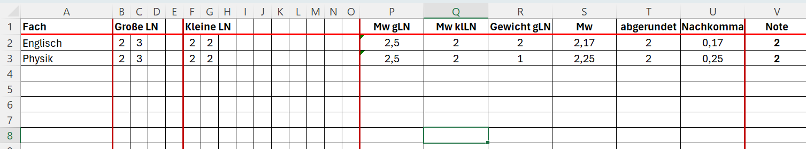
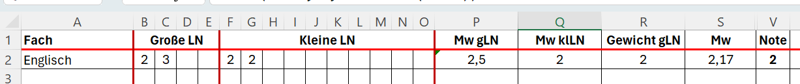

# Eine Notenverwaltung

## Rohfassung
Erstelle eine Tabelle nach diesem Muster:   
  
Verwende hierzu in folgenden Zellen spezielle Funktionen:
|Zelle|Funktion|
|---|---|
|P2|Mittelwert der Zellen B2 bis E2|
|Q2|Mittelwert der Zellen F2 bis O2|
|S2|(P2*R2+Q2) geteilt durch die (R2+1)|
|T2|Abrunden(S2;0)|
|U2|Nachkomma-Teil wird aus S2 und T2 berechnet|
|V2|Wenn U2<=0,5 ist, dann T2 sonst T2+1|

Kopiere die Funktionen in die Zeilen 3-15

## Elegantere Fassung

Die Berechnungen sollen nur angezeigt werden, wenn Noten eingetragen sind. Hierzu verwenden wir bedingte Funktionen.
|Zelle|Bedingte Funktion|
|----|----|
|P2|Wenn B2="", dann "" sonst Berechnung (s.o.)|
|Q2|Wenn F2="", dann "" sonst Berechnung (s.o.)|
|S2|Wenn P2="" oder Q2="", dann "" sonst Berechnung (s.o.)|
|T2|Wenn S2="", dann "" sonst Berechnung (s.o)|
|U2|Wenn T2="", dann "" sonst Berechnung (s.o)|
|V2|Wenn U2="", dann "" sonst Berechnung (s.o)|

Kopiere die Funktionen wieder über das gesamte Tabellenblatt.

## Ausblenden unwichtiger Spalten
Markiere die Spalten T und U und blende sie durch einen Rechtsklick aus.

## Formatieren des Tabellenblatts
1. Füge farbige Linien über Strg 1, Rahmen ein.
2. Markiere den Bereich B1 bis E1 und verbinde die Zellen (Strg 1, Ausrichtung)
3. Verbinde analog die Zellen F1 bis O1

