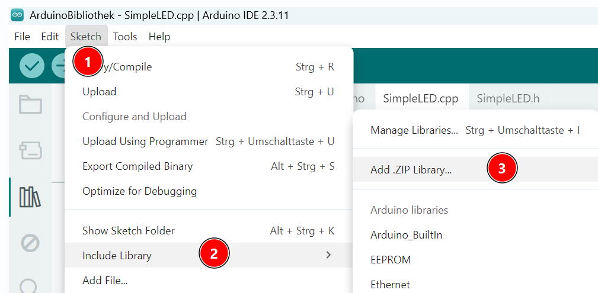

# Eigene Bibliotheken für Arduino entwickeln

## Grundlagen

Wolfgang Ewald beschreibt auf seiner Internetseite die Grundlagen der objektorientierten Programmierung und das Erstellen von Bibliotheken für Arduino:  
https://wolles-elektronikkiste.de/bibliotheken-und-klassen-erstellen-teil-i

## Header-Datei: SimpleLED.h

Die Header-Datei enthält die Deklarationen aller Klassen, Methoden und Attribute innerhalb der Bibliothek.  
Mit dieser Datei bekommt der Programmierer einen schnellen Überblick über die Eigenschaften und Fähigkeiten der in der Bibliothek definierten Klassen.  
Außerdem können hier erläuternde Kommentare hinterlegt werden.

```cpp
#ifndef SIMPLE_LED_H
#define SIMPLE_LED_H

#include <Arduino.h>

class SimpleLED {
public:
    SimpleLED(int pinNumber);

    void an();
    void aus();

protected:
    int pin;
};

#endif
```

**Erläuterungen zum Code**

```cpp
#ifndef SIMPLE_LED_H
#define SIMPLE_LED_H
...
#endif
```

Die Klasse `SimpleLED` soll im Code nur einmal definiert werden.  
Mit der Bedingung **`#ifndef SIMPLE_LED_H`** wird sichergestellt, dass der Inhalt der Header-Datei nur einmal eingebunden wird.

```cpp
#include <Arduino.h>
```

Bei der Programmierung einer Bibliothek muss die Grundbibliothek mit den Arduino-Befehlen von Hand eingebunden werden. Bei normalen Arduino-Programmen erledigt das System diesen Schritt automatisch.

```cpp
class SimpleLED {
...
};
```

Um in unserem Programm eine LED ansteuern zu können, müssen wir ein Objekt der Klasse **SimpleLED** erzeugen.  
Die Attribute (Eigenschaften) und Methoden (Fähigkeiten) der Objekte dieser Klasse werden in der Bibliothek definiert.

```cpp
public:
   ...
protected:
   ...
```

Attribute und Methoden, die mit **`public`** definiert sind, sind öffentlich sichtbar. Damit können sie im Programm außerhalb der Klasse aufgerufen und verändert werden. In der Regel definiert man nur die Methoden als `public`, um die Werte der Attribute vor unkontrollierten Änderungen zu schützen.

Mit **`protected`** definierte Attribute und Methoden sind vor einem direkten Zugriff von außen geschützt. Sie können innerhalb der Klasse und ihrer abgeleiteten Klassen verwendet werden.

```cpp
    SimpleLED(int pinNumber);  // Konstruktor
```

Der Konstruktor der Klasse wird aufgerufen, sobald ein neues Objekt der Klasse erzeugt wird. In unserem Fall hat er als Parameter die Nummer des Pins, an den die LED angeschlossen ist.

## Quelldatei: SimpleLED.cpp

In der Quelldatei steht der eigentliche Quellcode. Die in der Header-Datei deklarierten Methoden werden hier programmiert.

```cpp
#include "SimpleLED.h"

SimpleLED::SimpleLED(int pinNumber) {
   pin = pinNumber;
   pinMode(pin, OUTPUT);
}

void SimpleLED::an() {
    digitalWrite(pin, HIGH);
}

void SimpleLED::aus() {
    digitalWrite(pin, LOW);
}
```

### Erläuterungen zum Code

```cpp
#include "SimpleLED.h"
```

Die Header-Datei muss eingebunden werden. Damit weiß das System, welche Klassen, Methoden und Attribute deklariert sind.

```cpp
SimpleLED::SimpleLED(int pinNumber) {
    ...
}
```

In diesem Block wird der Konstruktor der Klasse definiert. Die Zeichen **`::`** legen die Zuordnung fest: Der Konstruktor und alle folgenden Methoden werden der Klasse `SimpleLED` zugeordnet.

## Installation der Bibliothek

Für die Verwendung in mehreren Arduino-Programmen sollte die Bibliothek dauerhaft installiert werden.

### Vorbereitung der Bibliothek

Die Header- und Quelldateien müssen in einen Ordner kopiert werden. Der Name des Ordners sollte durch einige zusätzliche Zeichen möglichst eindeutig sein. Wir fügen einfach einen Unterstrich und zwei Buchstaben hinzu:

- `SimpleLED_RH`
  - `SimpleLED.h`
  - `SimpleLED.cpp`

Dieser Ordner muss anschließend in eine ZIP-Datei komprimiert werden:

- `SimpleLED_RH.zip`
  - `SimpleLED_RH`
    - `SimpleLED.h`
    - `SimpleLED.cpp`

Auf der obersten Ebene des ZIP-Archivs dürfen keine Dateien, sondern nur der Ordner **`SimpleLED_RH`** liegen.

### Installation der Bibliothek

Die ZIP-Datei muss über die Arduino IDE installiert werden.



Dabei wird die Datei entpackt und im Sketchbook-Ordner von Arduino gespeichert. Den Speicherort dieses Ordners kannst du in den Voreinstellungen einsehen. In der Regel lautet er **Dokumente/Arduino**.  
Wenn die Bibliothek erneut installiert werden soll, muss ihr Ordner zuerst aus diesem Verzeichnis gelöscht werden.

## Verwenden der Bibliothek

### Arduino-Sketch

```cpp
#include <SimpleLED.h>

SimpleLED led = SimpleLED(2);

void setup() {}

void loop() {
    led.an();
    delay(500);
    led.aus();
    delay(500);
}
```

### Erläuterungen zum Code

```cpp
#include <SimpleLED.h>
```

Im Sketch muss die Bibliothek eingebunden werden. Zu Testzwecken reicht es, wenn die Header- und Quelldateien im selben Ordner wie der Arduino-Sketch stehen. Die Arduino IDE findet sie dort und kompiliert sie automatisch mit.  
Wenn die Bibliothek in mehreren Arduino-Programmen verwendet werden soll, ist es sinnvoll, sie dauerhaft zu installieren.

```cpp
SimpleLED led = SimpleLED(2);
```

In dieser Codezeile wird ein Objekt der Klasse `SimpleLED` erzeugt, indem der Konstruktor der Klasse aufgerufen wird. Der Name des Objekts lautet **`led`**. Mit dem Parameterwert `2` wird festgelegt, dass die LED an Pin 2 angeschlossen ist. Da alle anderen Festlegungen im Konstruktor getroffen werden, kann die Methode **`setup`** leer bleiben.

```cpp
void loop() {
    led.an();
    delay(500);
    led.aus();
    delay(500);
}
```

Die Methoden `an` und `aus` können jetzt im **`loop`**-Teil einfach über die Punktnotation aufgerufen werden. Durch die Verwendung der externen Bibliothek ist unser Code viel kürzer und besser lesbar geworden.

## Erweitern der Bibliothek: Überladen von Konstruktoren

Bisher setzt unsere Bibliothek voraus, dass die LED mit dem Pluspol an einem Pin und mit dem Minuspol an GND angeschlossen ist. Wenn der Pin `HIGH` ist, leuchtet sie; wenn er `LOW` ist, leuchtet sie nicht.  
Im Folgenden erweitern wir die Bibliothek so, dass die LED auch mit dem Pluspol dauerhaft an `+5 V` und mit dem Minuspol am Pin angeschlossen werden kann. Das Schaltverhalten kehrt sich dann um: `LOW` bedeutet „an“, `HIGH` bedeutet „aus“.

Hierzu erweitern wir die Header-Datei um einen neuen Konstruktor und ein neues Attribut:

```cpp
#ifndef SIMPLE_LED_H
#define SIMPLE_LED_H

#include <Arduino.h>

class SimpleLED {
public:
    SimpleLED(int pinNumber);
    SimpleLED(int pinNumber, int onLevel);

    void an();
    void aus();

protected:
    int pin;
    int onLevel;
};

#endif
```

Es werden also zwei verschiedene Konstruktoren angeboten: einer mit einem und einer mit zwei Parametern. Man spricht in diesem Fall von **überladenen Konstruktoren**. Abhängig von der Anzahl der Parameter wählt das System den passenden Konstruktor aus.

Die Quelldatei muss ebenfalls überarbeitet werden:

```cpp
#include "SimpleLED.h"

SimpleLED::SimpleLED(int pinNumber) {
    pin = pinNumber;
    pinMode(pin, OUTPUT);
    onLevel = HIGH;
}

SimpleLED::SimpleLED(int pinNumber, int onLevelWert) {
    pin = pinNumber;
    pinMode(pin, OUTPUT);
    onLevel = onLevelWert;
}

void SimpleLED::an() {
    digitalWrite(pin, onLevel);
}

void SimpleLED::aus() {
    digitalWrite(pin, !onLevel);
}
```

Das Attribut **`onLevel`** muss in beiden Konstruktoren initialisiert werden. Im ersten Fall wird es auf `HIGH` gesetzt, da der Pluspol der LED an den Pin angeschlossen ist. Beim zweiten Konstruktor muss der Wert als Parameter angegeben werden.

Die Methoden **`an`** und **`aus`** verwenden jetzt den Wert des Attributs **`onLevel`**. Durch den **`!`**-Operator wird dieser Wert beim Ausschalten umgekehrt.

Analog dazu können auch Methoden der Klasse überladen werden.
